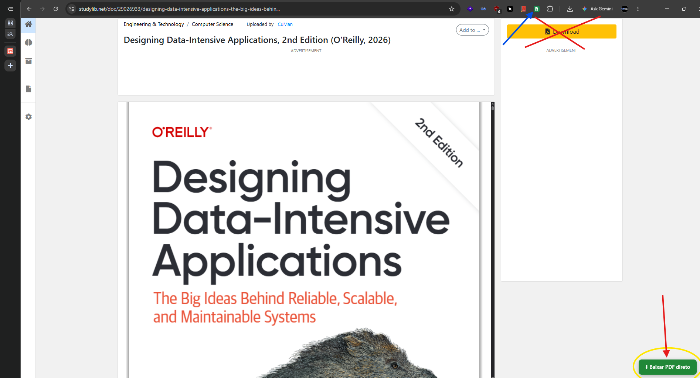
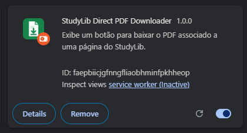

# StudyLib Direct PDF Downloader

Extensão de navegador que adiciona um botão às páginas de documentos do StudyLib. Após o clique, ela localiza um PDF associado ao documento e solicita o download pelo navegador.

## Problema que a extensão tenta resolver

Em algumas páginas, o fluxo de download apresentado pelo StudyLib pode exigir login e etapas como **Carregar**, **Analisar**, **Detalhes** e **Terminar** antes de liberar o botão oficial. Isso pode levar tempo e pedir que a pessoa compartilhe documentos próprios. Essa fricção motivou o projeto. A extensão adiciona um botão à página e, após o clique, solicita ao navegador o PDF associado ao documento.

**O botão não concede autorização para baixar o arquivo.** A extensão não verifica o consentimento do titular, pagamentos ou as condições específicas do documento. Se o download depender de login, envio de documentos, pagamento ou outra condição, siga o fluxo oficial; não use a extensão para evitar esses requisitos. O acordo do StudyLib afirma que o usuário não pode copiar o documento sem consentimento do titular e que documentos pagos dependem de pagamento prévio.

> **Distribuição:** este projeto é fornecido como código-fonte para instalação em modo de desenvolvedor. Não há publicação nas lojas de extensões nem hospedagem de PDFs pelo projeto.

## Recursos

- Botão flutuante; nenhum download começa sem clique do usuário.
- Localiza o PDF associado ao documento exibido.
- Download solicitado pela API nativa do navegador, com opção para escolher o destino.
- Código-fonte disponível para inspeção e alterações.

## Demonstração

Na primeira imagem, o botão da extensão aparece na página do documento. A segunda mostra a extensão carregada no Chrome.

## Compatibilidade

| Navegador | Manifesto | Pasta para carregar |
| --- | --- | --- |
| Chrome | Manifest V3 | Raiz deste repositório |
| Edge | Manifest V3 | Raiz deste repositório |
| Firefox | Manifest V3 (Gecko) | `dist/firefox`, após gerar o pacote |

## Instalação em modo de desenvolvedor

### Chrome

1. Abra `chrome://extensions`.
2. Ative **Modo do desenvolvedor**.
3. Clique em **Carregar sem compactação** e selecione a raiz deste repositório.
4. Abra uma página de documento do StudyLib e use **Baixar PDF direto**.

### Edge

1. Abra `edge://extensions`.
2. Ative **Modo do desenvolvedor**.
3. Clique em **Carregar sem compactação** e selecione a raiz deste repositório.

### Firefox

1. Execute `build-firefox.ps1` no PowerShell. O pacote será preparado em `dist/firefox`.
2. Abra `about:debugging#/runtime/this-firefox`.
3. Clique em **Load Temporary Add-on…** e selecione `dist/firefox/manifest.json`.

No Firefox, a instalação temporária é removida ao reiniciar o navegador. Este repositório não publica nem assina um pacote para instalação permanente.

## Permissões e privacidade

- `downloads`: inicia o download somente depois do clique no botão.
- Acesso às páginas e recursos do StudyLib: necessário para exibir o botão e localizar o PDF associado ao documento.
- A extensão não possui backend, conta, telemetria ou serviço próprio de hospedagem. Quando o usuário inicia um download, o navegador faz a solicitação ao endereço encontrado na página.

## Uso responsável e termos do StudyLib

A extensão localiza um recurso PDF associado à página e inicia o download quando o usuário clica no botão. **Ela não reproduz o fluxo normal do botão Download do StudyLib nem verifica se o titular autorizou o download de cada documento.** A presença de um recurso na página, por si só, não confirma que baixar aquele arquivo é permitido.

Antes de baixar, verifique os direitos, a licença e as condições aplicáveis ao documento. Não use a extensão para contornar pagamento, restrições de acesso ou condições de download; não redistribua documentos sem autorização. O usuário decide quando usar a extensão e é responsável pelo uso que faz dos arquivos.

O [acordo do StudyLib sobre documentos](https://studylib.net/agreement) condiciona o download à autorização do titular e prevê que documentos pagos sejam pagos antes do uso. Os [termos gerais do site](https://studylib.net/terms) também se aplicam. Consulte as versões vigentes e os termos específicos do documento.

O repositório contém somente o código da extensão e seus ícones. **Não inclua PDFs, URLs assinadas, tokens, cookies ou outros dados de acesso** em commits, issues, pull requests ou capturas de tela. O projeto não é afiliado, patrocinado ou endossado pelo StudyLib.

## Contribuições e problemas

Leia [CONTRIBUTING.md](CONTRIBUTING.md) antes de abrir uma contribuição. Para reportar um defeito ou sugerir uma melhoria, use os modelos na aba **Issues** do GitHub. Remova tokens e URLs assinadas de qualquer relato.

## Licença

O código original deste repositório está sob a licença [MIT](LICENSE). Ela cobre somente o código e os demais materiais originais deste projeto; não concede direitos sobre documentos, conteúdo, serviços ou marcas do StudyLib ou de terceiros.
